<p align="center">
  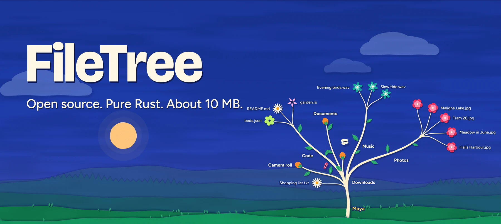
</p>

<h3 align="center">A file browser that is an actual tree.</h3>

<p align="center">
  Your disks start as little blossoms. Every folder you open grows a branch,<br>
  and every file is a flower that blooms, in a small paper world that follows your clock.
</p>

<p align="center">
  <a href="https://github.com/vuln7/FileTree/releases/latest/download/FileTree.exe">
    
  </a>
</p>

<p align="center">
  <sub><b>Nothing to install.</b> Download it, double-click it, and it opens on your own disks.</sub>
</p>

<p align="center">
  
  
  
  
</p>

<br>

<p align="center">
  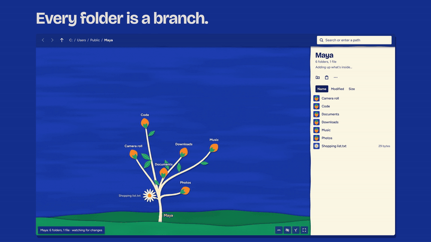
</p>

<p align="center">
  <a href="https://github.com/vuln7/FileTree/releases/latest/download/filetree-showcase-4k.mp4">
    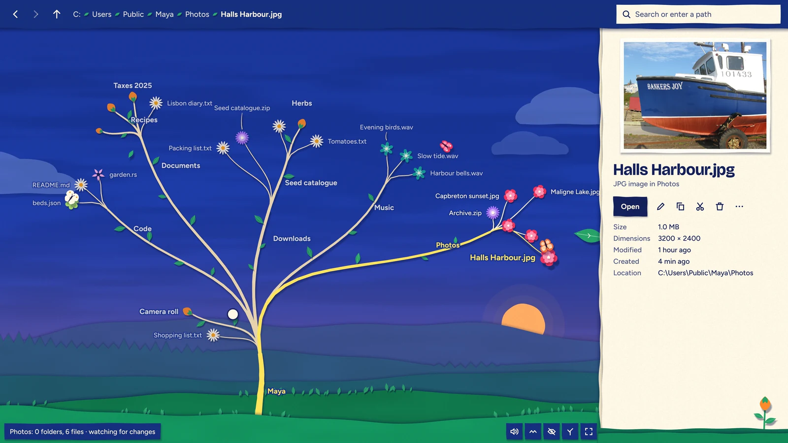
  </a>
  <br>
  <sub><a href="https://github.com/vuln7/FileTree/releases/latest/download/filetree-showcase-4k.mp4"><b>Watch the two-minute showcase</b></a>: a whole day goes by while it's used. 4K, 60 FPS, with sound, about 200 MB.</sub>
</p>

> [!NOTE]
> The exe isn't signed yet, so Windows may warn you the first time. Choose **More info**, then **Run anyway**. FileTree doesn't use the internet, and your files stay on your computer. Every release is [built by GitHub from this public source](https://github.com/vuln7/FileTree/actions/workflows/release.yml), so you can [check your download](#check-your-download).

<br>

## Everything you'd open Explorer for

<table>
  <tr>
    <td width="50%" valign="top">
      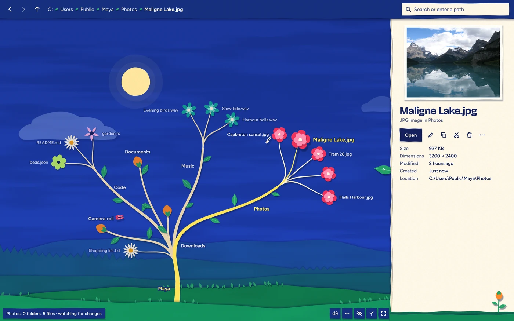
      <br><b>See it without opening it</b>
      <br><sub>Click a flower for a preview, its size and dates, and everything you can do with it. Double-click to open it, just like Explorer.</sub>
    </td>
    <td width="50%" valign="top">
      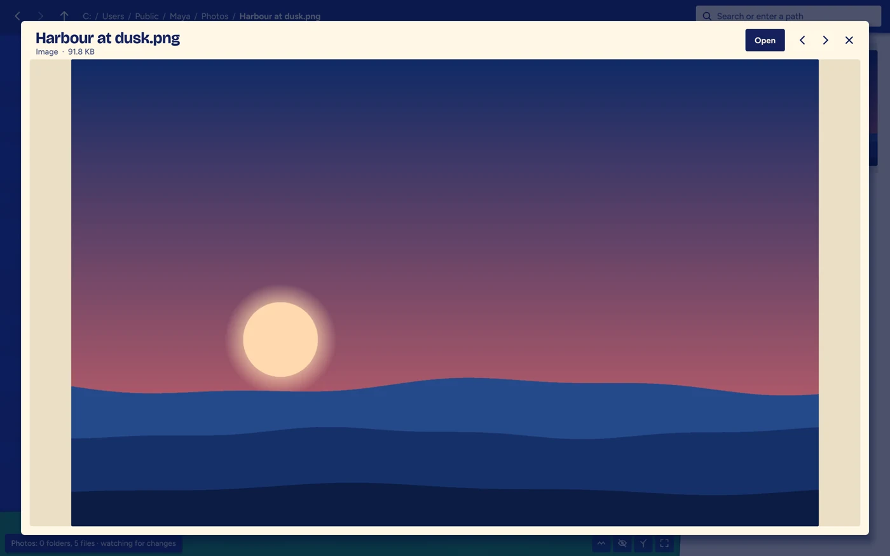
      <br><b>Quick Look</b>
      <br><sub>Press <kbd>Space</kbd> to fill the window. Zoom, pan, and step through the folder with the arrow keys.</sub>
    </td>
  </tr>
  <tr>
    <td width="50%" valign="top">
      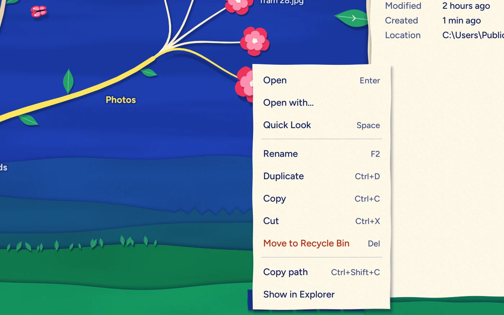
      <br><b>Right-click for everything</b>
      <br><sub>Rename, duplicate, copy, cut, zip, unzip, open with, and open a terminal here.</sub>
    </td>
    <td width="50%" valign="top">
      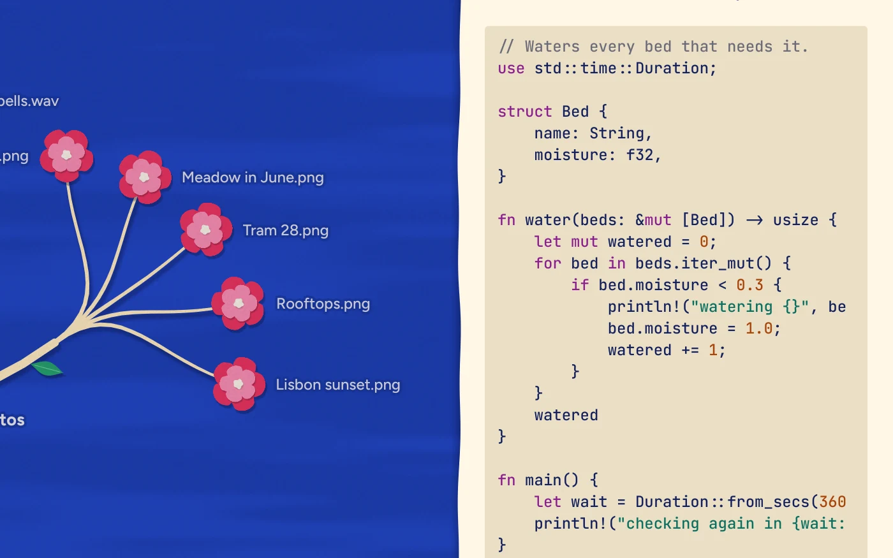
      <br><b>Read code in colour</b>
      <br><sub>Text and source code show right in the panel. So does what's inside a zip.</sub>
    </td>
  </tr>
  <tr>
    <td width="50%" valign="top">
      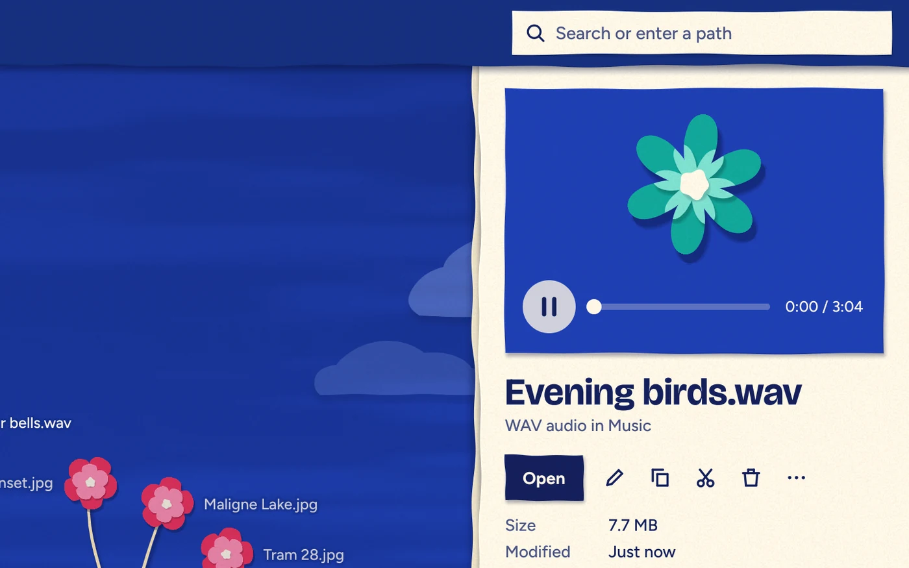
      <br><b>Play music where it is</b>
      <br><sub>MP3, WAV, FLAC, OGG, and more, with a seek bar. Nothing else needs to open.</sub>
    </td>
    <td width="50%" valign="top">
      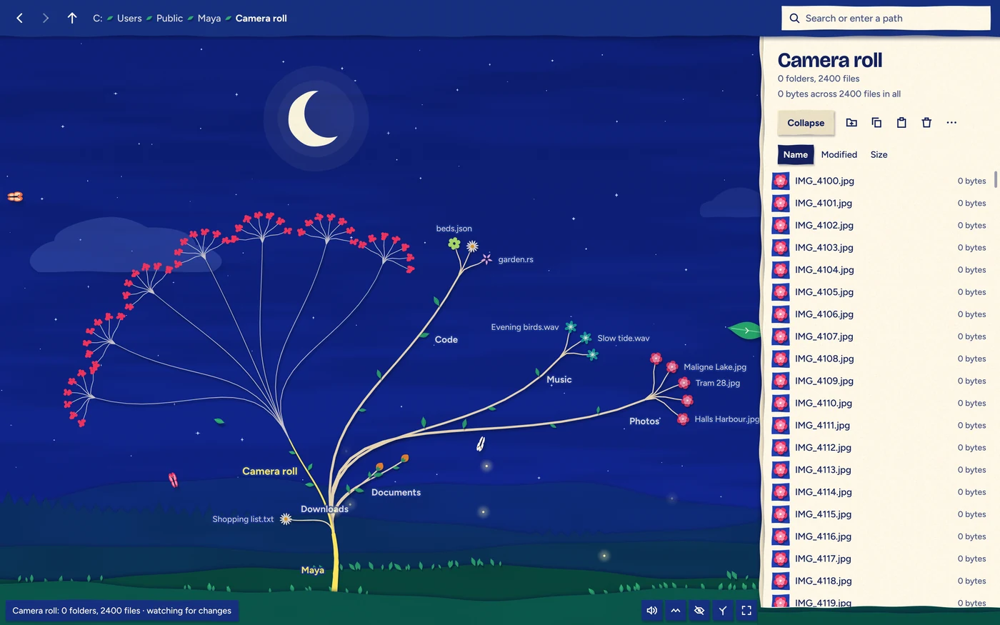
      <br><b>Thousands of files become a crown</b>
      <br><sub>Huge folders stay readable and fast. Zoom in and every file is its own flower.</sub>
    </td>
  </tr>
</table>

<br>

## Drag it. Undo it.

<p align="center">
  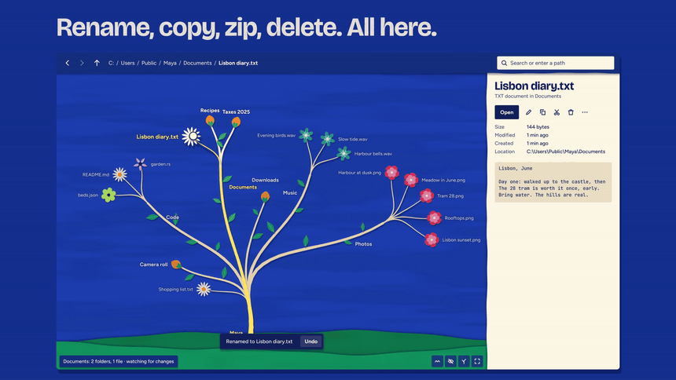
</p>

Press and hold a flower for a moment, then carry it onto any folder to move it, or hold <kbd>Ctrl</kbd> to copy. Hold over a closed folder and it opens for you.

**Your files are safe:**

- Deleting moves things to the Recycle Bin, and you can browse and restore from it right in the app.
- Nothing is ever overwritten. If a name is taken, the new one becomes `name (2)`.
- Moves, renames, copies, new items, and deletes can all be undone.
- Changing something Windows relies on asks you first.

<br>

## A flower for every kind of file

<p align="center">
  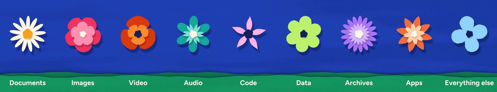
</p>

Told apart by shape as well as colour, so you can read a branch at a glance.

<br>

## A world that follows your clock

<p align="center">
  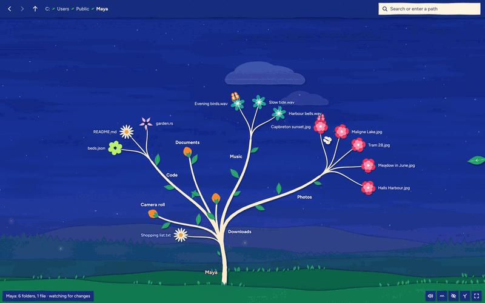
</p>

The tree stands in a small world cut from the same paper, and it's the real time of day where you are.

<table>
  <tr>
    <td width="25%" valign="top">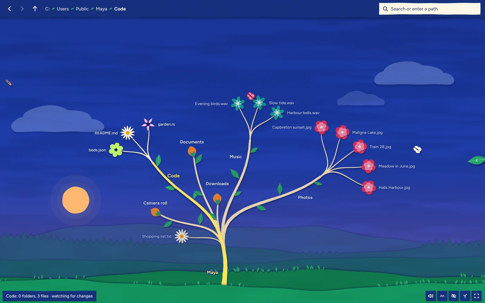<br><sub><b>Sunrise</b></sub></td>
    <td width="25%" valign="top">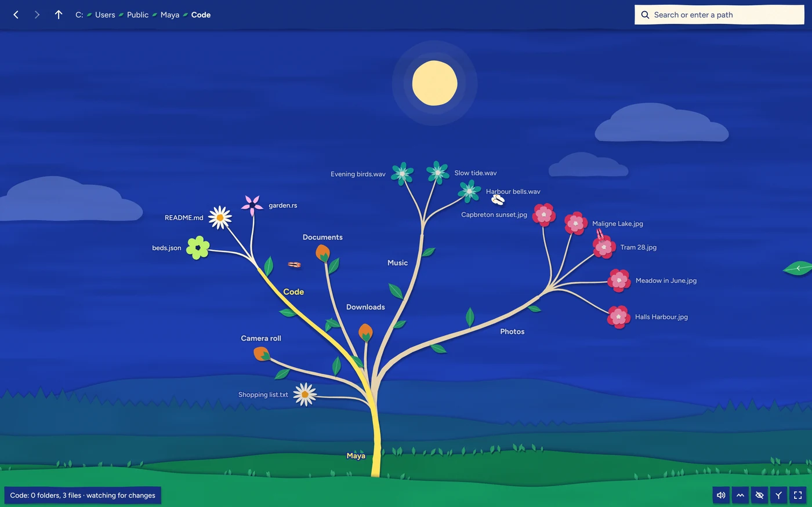<br><sub><b>Midday</b></sub></td>
    <td width="25%" valign="top">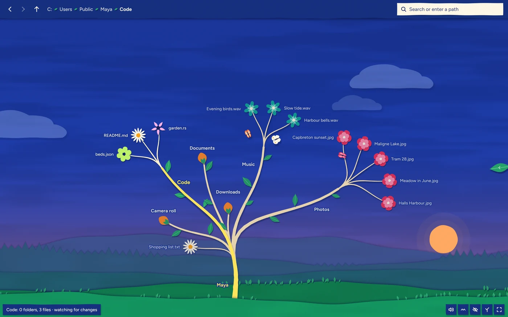<br><sub><b>Sunset</b></sub></td>
    <td width="25%" valign="top">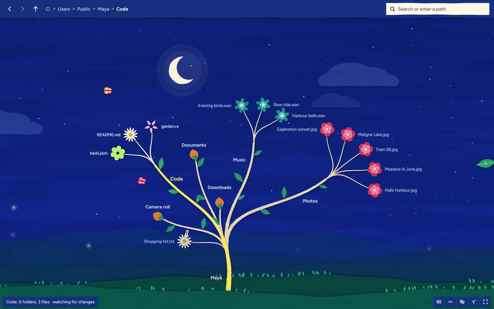<br><sub><b>Night</b></sub></td>
  </tr>
</table>

- **The sky:** the sun crosses and sets into the hills, the horizon warms at either end of the day, then come a crescent moon and stars.
- **The land:** clouds drift over layered hills, and the grass and the whole tree lean with the gusts.
- **The life:** butterflies perch on your flowers, and one flies over to whichever file you select. Birds pass by day, leaves fall from your branches, and fireflies come out at night.

It's all scenery. Nothing in it can be clicked or gets in front of a name, and nothing is shaped like a flower, because a flower always means a file. Press <kbd>Ctrl</kbd> <kbd>B</kbd> to put the side panel away and give it the whole window, or turn on reduced motion to keep it still.

**You can hear it too.** Petals unfold, branches creak as they reach out, and the leaves shake when you set something down. The sounds are quiet and only answer what you do, with no background sound. They're made from plain maths as they play, so there are no recordings inside. Press <kbd>Ctrl</kbd> <kbd>M</kbd> to turn them off.

<br>

## Light enough to forget

It draws directly on your graphics card with no browser engine inside. The world around the tree only moves while you're there: put another window in front, or leave it alone for three minutes, and it comes to a stop and draws nothing.

| | Measured on one Windows 11 PC |
|---|---|
| **Window on screen** | About half a second |
| **In front of you, with the world moving** | About 6% of one CPU core and 10% of the graphics card |
| **Behind another window** | Effectively none |
| **Memory while active** | About 155 MB |
| **Memory after a pause** | About 5 MB or less in use, with about 180 MB kept reserved |

It adapts to your machine by itself: your disks, your folders, your screen scaling, and your reduced-motion setting. With no working graphics card, it falls back to drawing in software and keeps the scenery still.

<br>

## Shortcuts

<details>
<summary><b>Show all the shortcuts</b></summary>
<br>

| Action | Mouse | Keyboard |
|---|---|---|
| Select | Click | |
| Open or close a folder | Double-click | <kbd>Space</kbd> or <kbd>Enter</kbd> |
| Close everything | Sprout button | <kbd>Ctrl</kbd> <kbd>R</kbd> |
| Move around the tree | Click | <kbd>←</kbd> <kbd>→</kbd> <kbd>↑</kbd> <kbd>↓</kbd> |
| Open a file | Double-click | <kbd>Enter</kbd> |
| Quick Look | Click the preview | <kbd>Space</kbd> |
| Rename | Pencil button | <kbd>F2</kbd> |
| Copy, cut, paste | Panel buttons | <kbd>Ctrl</kbd> <kbd>C</kbd>, <kbd>Ctrl</kbd> <kbd>X</kbd>, <kbd>Ctrl</kbd> <kbd>V</kbd> |
| Duplicate | Right-click | <kbd>Ctrl</kbd> <kbd>D</kbd> |
| Move to the Recycle Bin | Bin button | <kbd>Del</kbd> |
| New folder | Right-click | <kbd>Ctrl</kbd> <kbd>Shift</kbd> <kbd>N</kbd> |
| New file | Right-click | <kbd>Ctrl</kbd> <kbd>N</kbd> |
| Undo | Undo on the message | <kbd>Ctrl</kbd> <kbd>Z</kbd> |
| Select several | <kbd>Ctrl</kbd>-click, or <kbd>Shift</kbd>-click in the list | <kbd>Ctrl</kbd> <kbd>A</kbd> |
| Search or go to a path | Search box | Just start typing |
| Hide or show the side panel | Tab on the panel's edge | <kbd>Ctrl</kbd> <kbd>B</kbd> |
| Pan and zoom | Drag and scroll | |
| Fit the whole tree | Corner button | <kbd>Home</kbd> |
| Back and forward | Toolbar | <kbd>Alt</kbd> <kbd>←</kbd>, <kbd>Alt</kbd> <kbd>→</kbd> |
| Up a level | Toolbar | <kbd>Backspace</kbd> |
| Show hidden files | Eye button | <kbd>Ctrl</kbd> <kbd>H</kbd> |
| Turn sounds on or off | Speaker button | <kbd>Ctrl</kbd> <kbd>M</kbd> |

</details>

<details>
<summary><b>What it doesn't do yet</b></summary>
<br>

- Video and PDF show a thumbnail. Playing or paging through them opens another program.
- It can't permanently delete anything or empty the Recycle Bin. That's on purpose.
- Permissions, sharing, and network drives aren't covered.
- Only zip archives can be looked inside or unpacked.
- The download is for Windows. The code is written with macOS and Linux in mind, but they're untested.

</details>

<a name="check-your-download"></a>
<details>
<summary><b>Check your download</b></summary>
<br>

Every release on the [Releases page](https://github.com/vuln7/FileTree/releases) is compiled by a [public GitHub workflow](.github/workflows/release.yml), not on anyone's own computer.

Compare the file's checksum with the SHA-256 in the release notes. In PowerShell:

```powershell
Get-FileHash FileTree.exe
```

To confirm GitHub built this exact file from this repository, use the [GitHub CLI](https://cli.github.com):

```bash
gh attestation verify FileTree.exe --repo vuln7/FileTree
```

</details>

<details>
<summary><b>Build it yourself</b></summary>
<br>

Install [Rust](https://rustup.rs), then:

```bash
cargo run --release
```

| File | What it does |
|---|---|
| `src/fs.rs` | Disk access on background threads: listing, watching, searching, previews |
| `src/ops.rs` | Changes to files, and how to undo each one |
| `src/tree.rs`, `src/layout.rs` | The tree, and shaping it so branches never overlap |
| `src/scene.rs`, `src/shaders.wgsl` | Motion, and drawing all the paper with no meshes or textures |
| `src/garden.rs` | The time of day, the wind, and everything that lives around the tree |
| `src/sounds.rs` | The sounds of handling the tree, worked out as they play |
| `src/ui.rs`, `src/overlay.rs` | Toolbar, panel, menus, dialogs, and Quick Look |
| `src/app.rs`, `src/actions.rs` | State, behaviour, and every command |
| `src/capture.rs` | With `--features capture`, runs the app from a script with no window |

Run the tests with `cargo test`.

</details>

<br>

## License

[MIT](LICENSE). The fonts in `assets/fonts` are under the SIL Open Font License. Licenses for the libraries inside the exe are in [THIRD-PARTY-LICENSES.txt](THIRD-PARTY-LICENSES.txt).

The photos in these pictures and the video are in the public domain, from Wikimedia Commons, by Tangopaso, RobNS, Wheateater, Ramessos, and bengoa.
